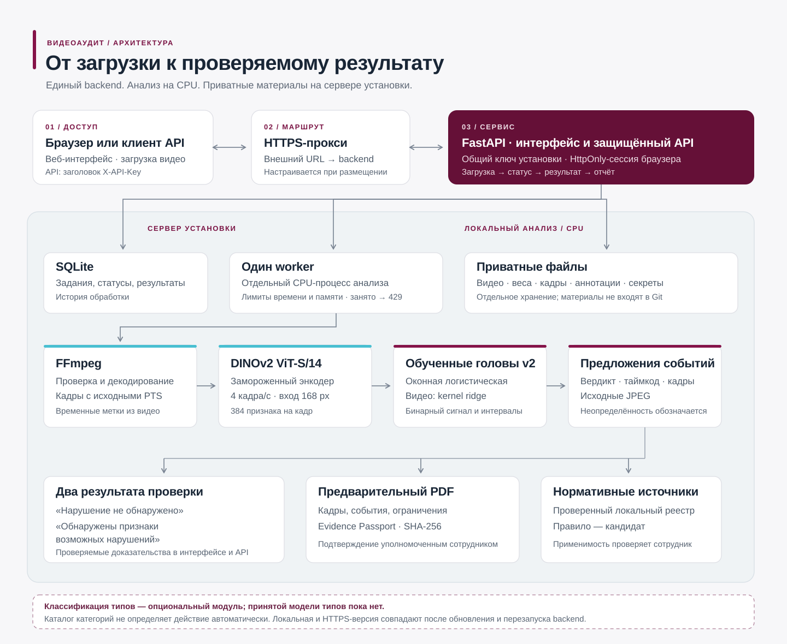
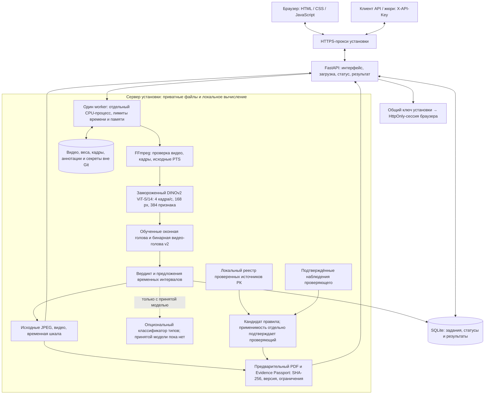

# Архитектура видеоаудита

Один backend обслуживает веб-интерфейс и API. Анализ выполняется на CPU на сервере установки: после подготовки весов облачный AI не требуется. GitHub хранит код; опубликованный сайт работает только после обновления и запуска backend на машине размещения.

[Открыть схему отдельно](architecture.svg).

## Как проходит проверка

1. Пользователь входит с ключом установки и загружает файл. API принимает тот же ключ в `X-API-Key`; браузер получает отдельную HttpOnly-сессию на восемь часов. Ключ не встраивается в HTML или JavaScript.
2. FastAPI проверяет загрузку, сохраняет задание в SQLite и резервирует единственный слот worker. Если слот занят, клиент получает `429`. Анализ запускается в отдельном процессе с ограничениями времени и памяти; обращения анализатора в сеть блокируются.
3. FFmpeg проверяет декодирование и извлекает выборку кадров с исходными временными метками. DINOv2 преобразует кадры в признаки. Оконная голова предлагает интервалы, видео-голова v2 определяет бинарный результат. При достаточном бюджете времени возможно уточнение выделенных участков до восьми кадров в секунду.
4. Сервис возвращает один из двух вердиктов: «Нарушение не обнаружено» или «Обнаружены признаки возможных нарушений». Из исходного видео извлекаются JPEG-кадры. Если момент события не установлен, интерфейс обозначает контекстные кадры и неопределённую локализацию.
5. Интерфейс показывает результат и доказательства; API, PDF и паспорт доступны после авторизации. Паспорт фиксирует происхождение, параметры анализа и SHA-256. PDF имеет статус предварительного акта, требующего подтверждения уполномоченным сотрудником.

## Типы, нормативы и проверка человеком

В обработке предусмотрено подключение `types.npz` для локализованного интервала. **Принятого классификатора типов сейчас нет.** Каталоги действий и возможных нарушений помогают разметке и подбору справочных источников; они не подтверждают, что действие действительно произошло.

Нормативный реестр хранится локально. Сервис может предложить проверенный источник РК как кандидата для известной категории. Наблюдаемый факт и условия применимости нормы проверяются отдельно; ссылка сама по себе не устанавливает нарушение. Приоритет задаётся политикой команды, а не вычисляется из текста нормативного акта.

Ручная разметка включается отдельным режимом. Наблюдения, подтверждение целевого события и подтверждение применимости нормы хранятся раздельно. Исследовательские модели не заменяют рабочий профиль автоматически. Распознавание личности по лицу не используется.

## Локальный адрес и опубликованный сайт

`http://127.0.0.1:8000/` — адрес backend на той машине, где он запущен. `https://cashframe-vangogh.tailb541d9.ts.net/` — внешний адрес установки команды. Чтобы они показывали одну версию, на машине размещения нужны актуальный код `main`, совместимые локальные веса, приватная конфигурация и перезапуск сервиса. Один `git push` не обновляет работающий процесс.

Схема показывает целевой путь через HTTPS-прокси; фактическую версию и готовность опубликованного backend проверяют отдельно. Инструкция запуска и передачи приватных файлов: [размещение](deployment.md), [чеклист жюри](jury-checklist.md).
