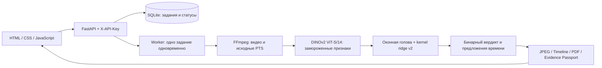

# Архитектура и фактические возможности

Актуально после исправления прогресса Windows 18.10.2026. Приложение — один локальный сервис с интерфейсом, API, ограниченным фоновым worker и отдельным CPU-процессом анализа.

В спринте качества 18.10 проверены три бинарных кандидата; улучшение validation не подтверждено, активные веса v2 сохранены. Добавлены защищённая opt-in разметка `/dataset-review`, отдельное покрытие источников, версионируемый bridge в схему TCN и каталог предлагаемых нарушений `config/violation-types.json`. Обычное наблюдение не поступает в обучение детектора без отдельного подтверждения целевого события. Каталог не является обученным классификатором. Подробности и фактические ограничения — в [отчёте спринта](2026-10-18-quality-sprint-results.md).

Энкодер получает выборки около 4 кадров/с, размер входа 168px, и формирует признаки размерности 384. Оконная логистическая голова оценивает временные окна; v2 kernel ridge принимает бинарное решение уровня видео. Временная локализация оценивается отдельно и может вернуть нерешённый момент. При этом контекстные кадры не называются установленным моментом нарушения. Это не обученный временной классификатор кассовых действий.

Результаты, загруженные видео, кэш признаков, веса и аннотации хранятся локально. ReportLab создаёт предварительный PDF; паспорт сохраняет происхождение, параметры и SHA-256. Реестр норм локальный; подтверждённые человеком наблюдения и применимость нормы хранятся отдельно от ответа модели. Обязательная схема API остаётся бинарной и не расширяется произвольными полями.

## Активная модель и эксперименты

| Ветка | Что действительно сделано | В рабочем профиле |
|---|---|---|
| DINOv2 + v2 | Замороженный энкодер, обученные оконная и видео-головы на исходных данных | Да |
| Слабонаблюдаемый point localizer | Обучена отдельная голова по исходным точкам; качество локализации неустойчиво | Нет, отдельный профиль |
| v3 / v4 | Новые дескрипторы, регуляризация, шум признаков и mixup; validation не улучшено | Нет |
| SigLIP | Предварительно обученная модель исследована локально для предложений типов, 18/18 отказов | Нет |
| TCN | Код требует проверенных интервалов событий; на выдуманных границах не обучался | Нет |
| Классификатор типов | Подготовлены каталог, импорт, trainer и проверки; подтверждённых типов нет | Не обучен |

Новые внешние датасеты не добавлялись в train; подробности прав и соответствия задачам — в [проверке данных](2026-10-18-action-and-data-review.md). DINOv2 и SigLIP в этой итерации не дообучались: дополнительное обучение относится к небольшим головам на старых признаках. Рабочая нейросетевая архитектура не заменена более глубокой.

Регрессия v2 на восьми ранее использованных test-видео: accuracy 62,5%, precision 57,1%, recall 100%, F1 72,7%, TN 1 / FP 3 / FN 0 / TP 4. Независимый новый ракурс не проверен. Точность специфических действий неизвестна, поскольку нет эталонных типов.

## Почему пока нет класса, нормы и приоритета

`config/action-types.json` содержит пять инженерных категорий действий и отказ `unknown`. Это каталог для разметки, а не обученные классы нарушения. Исходные Excel/CSV содержат бинарную метку и точку времени, без подтверждённого типа. В отдельной assisted-таблице появились колонки предложений; все 18 локально проверенных точек остались `unknown`, test-точки исключены.

Потенциальные связи: пересчёт и хранение — п.20 Правил НБРК №231; уход — п.22 при доказанном незавершённом обслуживании; документ — п.19 подп.6 при подтверждённом контексте приёма денег. Передача наличных сама по себе не устанавливает нарушение и автоматической нормы не получает. Отдельные условия нельзя вывести из общего сходства кадра.

`config/priorities.json` пока содержит пустую политику `types`. Поэтому приоритет не задан; нормативный акт не превращается автоматически в шкалу high/medium/low. Значения требуют отдельной политики команды и подтверждённого типа.

## Исправленная ошибка X-46

Причина: `os.replace(stage.tmp, stage.json)` завершился WinError 5, когда Windows не разрешил замену открытого снимка прогресса. Вспомогательное обновление статуса обрывало анализ. Теперь выполняются три короткие попытки; при сохраняющейся блокировке остаётся последний целый снимок, следующий отчёт повторяет запись. Успешность анализа не зависит от временного доступа к этому файлу. Проверка NaN/счётчиков и правило 100% после сохранения результата сохранены.

Ошибка воспроизведена тестом с настоящим Windows handle без разрешения удаления; тест не проходил до исправления и проходит после. Тот же загруженный X-46 повторно прошёл API за 21,578 с: `done`, три валидных JPEG, строгая схема сохранена, сеть анализатора заблокирована. Это проверка исправления сбоя, не новая оценка точности. Прежняя запись failed оставлена в истории.

Проверки после исправления: 177 Python и 29 frontend, включая три регрессии блокировки файла прогресса. Синтетические desktop/mobile скриншоты: `local/audit/hero-static-*.png`; реальный повтор X-46: `local/audit/x46-retry.json`.
